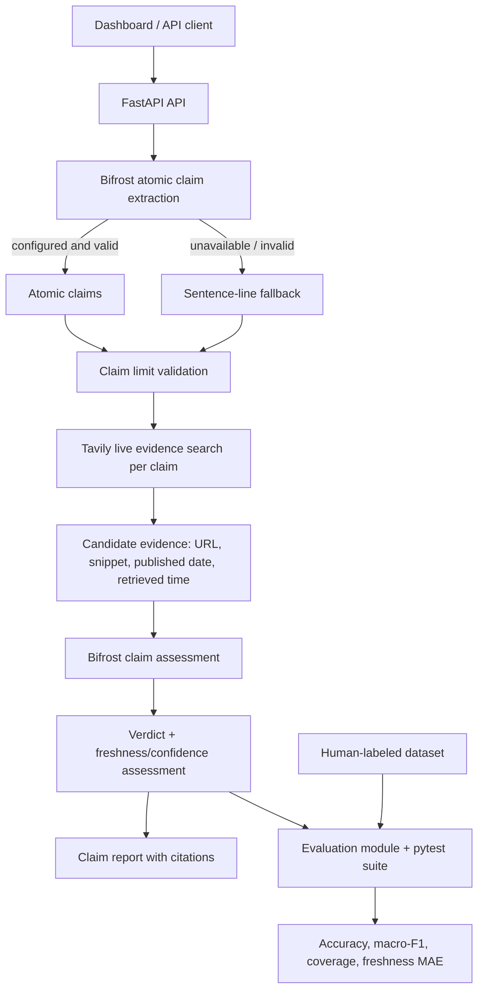

# VeriFact AI architecture

## Claim extraction

Bifrost attempts to split compound statements into independent factual claims. If the gateway is unavailable or returns invalid output, the service falls back to sentence/line splitting. The method is returned to the client.

## Evidence retrieval

Each claim is searched through Tavily. Returned evidence includes source title, HTTP(S) URL, snippet, search relevance score, publication date when supplied, and retrieval timestamp. Search relevance is not proof of correctness.

## Assessment

Bifrost receives the claim and candidate evidence. The prompt treats evidence as untrusted data and asks for one of four verdicts:

- supported
- contradicted
- potentially_stale
- inconclusive

Freshness and confidence scores are explicitly marked uncalibrated until a human-labeled dataset is used for calibration.

## Evaluation

Evaluation metrics are implemented in the evaluation module and covered by pytest tests. The current repository does **not** provide a standalone CLI evaluator. Metrics include accuracy, macro-F1, coverage, confusion matrix, per-class metrics, and freshness-score MAE where human scores exist.

No accuracy claim is made from the single demo fixture.
